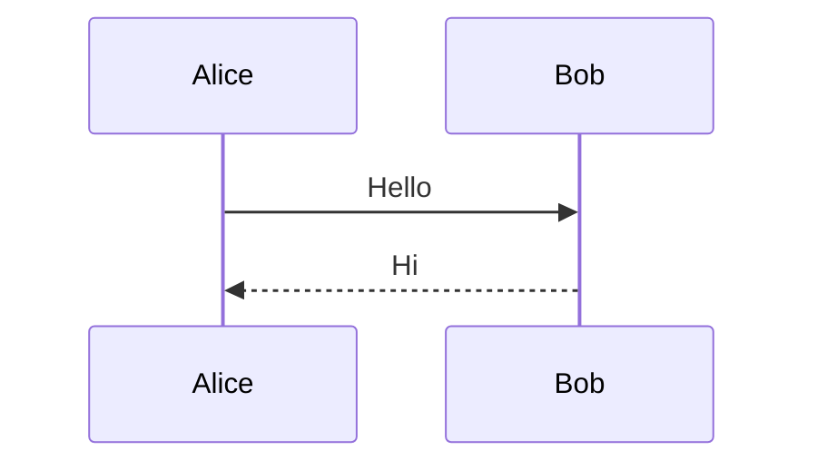

# mq — blog kỹ thuật tĩnh

Blog cá nhân viết bằng [Astro](https://astro.build), xuất bản thành trang tĩnh và deploy lên GitHub Pages. Nội dung tập trung vào khoa học máy tính, mật mã học, bảo mật web và write-up CTF, nên có hỗ trợ đầy đủ công thức toán (KaTeX) và sơ đồ (Mermaid).

Bạn chỉ cần viết bài dưới dạng file `.md`, đặt vào `src/content/posts/`, và bài sẽ tự xuất hiện trên trang.

## Yêu cầu

- **Node.js 20 trở lên** (CI dùng Node 22).
- npm (đi kèm Node).

## Cài đặt và chạy

```bash
npm install        # cài dependency (chỉ cần làm một lần)
npm run dev        # chạy server phát triển tại http://localhost:4321
npm run build      # build trang tĩnh vào thư mục dist/
npm run preview    # xem thử bản đã build
```

## Viết bài mới

### Tạo nhanh bằng script

```bash
npm run new -- "Tiêu đề bài viết"            # tạo src/content/posts/tieu-de-bai-viet.md
npm run new -- "Tiêu đề bài viết" --folder   # tạo src/content/posts/tieu-de-bai-viet/index.md
```

Script tự bỏ dấu tiếng Việt để tạo slug, điền sẵn frontmatter với `draft: true`, và từ chối ghi đè nếu bài đã tồn tại.

### Hai cách đặt file

| Cách | Đường dẫn | Khi nào dùng |
|---|---|---|
| File đơn | `src/content/posts/ten-bai.md` | Bài chỉ có chữ và code |
| Thư mục | `src/content/posts/ten-bai/index.md` | Bài có ảnh đi kèm |

Với cách thư mục, ảnh đặt cùng thư mục với `index.md` và tham chiếu bằng đường dẫn tương đối:

```text
src/content/posts/ten-bai/
├── index.md
├── thumbnail.png
└── hinh-1.png
```

Slug (phần URL) lấy từ tên file hoặc tên thư mục. Đặt tên bằng chữ thường, không dấu, nối bằng dấu gạch ngang, ví dụ `rsa-from-the-ground-up`. Đường dẫn bài là `/posts/<slug>/`.

### Frontmatter

Mỗi bài bắt đầu bằng khối YAML giữa hai dòng `---`:

```yaml
---
title: "Tiêu đề bài viết"
description: "Mô tả ngắn, hiển thị dưới tiêu đề trong danh sách."
pubDate: 2026-11-26
updatedDate: 2026-12-01
category: "Cryptography"
tags: ["RSA", "Number Theory"]
thumbnail: ./thumbnail.png
thumbnailAlt: "Mô tả ảnh cho người dùng trình đọc màn hình"
difficulty: "Medium"
event: "picoCTF 2026"
points: 300
math: true
draft: false
---
```

| Trường | Bắt buộc | Ý nghĩa |
|---|:---:|---|
| `title` | Có | Tiêu đề bài viết. |
| `description` | Có | Mô tả ngắn, hiện ở thẻ bài và thẻ meta. Để `""` nếu chưa có. |
| `pubDate` | Có | Ngày đăng, định dạng `YYYY-MM-DD`. Bài được sắp xếp theo ngày này, mới nhất lên đầu. |
| `category` | Có | Danh mục chính, ví dụ `Cryptography`, `CTF`, `Web Security`, `Guide`. Hiện dưới dạng nhãn màu đậm trên thẻ. |
| `tags` | Không | Danh sách thẻ, mặc định là `[]`. Dùng để lọc ở trang Tags và tìm bài liên quan. |
| `updatedDate` | Không | Ngày cập nhật gần nhất, hiện trong phần thông tin bài nếu có. |
| `thumbnail` | Không | Ảnh đại diện, đường dẫn tương đối tới file ảnh cạnh `index.md`. Nếu bỏ trống, trang sẽ dùng ảnh gradient mặc định theo danh mục. |
| `thumbnailAlt` | Không | Mô tả thay thế cho ảnh đại diện. Nên điền khi có `thumbnail`. |
| `difficulty` | Chỉ CTF | Một trong `Easy`, `Medium`, `Hard`, `Insane`. Bỏ qua với bài không phải CTF. |
| `event` | Chỉ CTF | Tên cuộc thi hoặc nguồn bài (ví dụ `Practice`). Bỏ qua nếu không phù hợp. |
| `points` | Chỉ CTF | Điểm của thử thách. Bỏ qua nếu không có. |
| `math` | Không | Chỉ mang tính thông tin, đánh dấu bài có công thức. Không ảnh hưởng đến việc render. |
| `draft` | Không | `true` thì bài bị ẩn khỏi bản production. Mặc định `false`. |

Các trường không bắt buộc có thể để dạng comment (`# ...`) hoặc xóa hẳn. Trang sẽ ẩn phần tương ứng khi thiếu dữ liệu.

### Bản nháp (`draft`)

- Bài có `draft: true` **chỉ hiện khi chạy `npm run dev`**, kèm để bạn xem trước.
- Khi build production (`npm run build`, và cả trên GitHub Pages), bài nháp bị loại khỏi danh sách, trang tag và RSS.
- Khi sẵn sàng đăng, đổi thành `draft: false` rồi commit và push.

## Cú pháp Markdown được hỗ trợ

Ngoài Markdown chuẩn (tiêu đề, danh sách, liên kết, trích dẫn, bảng), blog hỗ trợ các phần sau.

### Công thức toán (KaTeX)

Công thức inline dùng dấu `$`:

```markdown
Với $\gcd(a, n) = 1$, ta có $a^{\varphi(n)} \equiv 1 \pmod n$.
```

Công thức khối dùng `$$`:

```markdown
$$
c \equiv m^{e} \pmod{n}
$$
```

Nhiều dòng dùng môi trường `aligned`:

```markdown
$$
\begin{aligned}
n &= p \cdot q \\
\varphi(n) &= (p-1)(q-1)
\end{aligned}
$$
```

Các macro có sẵn:

| Gõ | Hiển thị | Gõ | Hiển thị |
|---|---|---|---|
| `\Z` | $\mathbb{Z}$ | `\lcm` | $\operatorname{lcm}$ |
| `\N` | $\mathbb{N}$ | `\ord` | $\operatorname{ord}$ |
| `\F` | $\mathbb{F}$ | | |

Công thức quá rộng sẽ cuộn ngang thay vì tràn ra ngoài trang.

### Code

Dùng khối code với tên ngôn ngữ:

````markdown
```python
print("hello")
```
````

Tùy chọn đặt sau tên ngôn ngữ:

- `title="ten-file.py"`: hiện tên file trên đầu khối (thay cho tên ngôn ngữ).
- `linenums`: bật số dòng. Mặc định bật cho ngôn ngữ lập trình.
- `nolinenums`: tắt số dòng.

````markdown
```python title="solve.py" nolinenums
print("flag{...}")
```
````

Code inline dùng dấu backtick: `` `pow(e, -1, phi)` ``.

### Khối terminal

Các ngôn ngữ `bash`, `sh`, `shell`, `zsh`, `console`, `powershell` và `text-terminal` hiện dưới dạng cửa sổ terminal, không có số dòng:

````markdown
```bash
$ openssl rand -hex 16
3f9a0c71e2b84d5a9c6e1f7b2d4a8e30
```
````

### Sơ đồ Mermaid

````markdown

````

Có thể dùng `flowchart`, `sequenceDiagram`, `stateDiagram-v2` và các loại khác của Mermaid. Sơ đồ tự vẽ lại khi đổi giữa chế độ sáng và tối.

### Callout

Năm loại callout, viết như blockquote của GitHub:

```markdown
> [!NOTE]
> Ghi chú thông tin bổ sung.

> [!TIP]
> Mẹo hữu ích.

> [!IMPORTANT]
> Điều bắt buộc phải nắm.

> [!WARNING]
> Cảnh báo về lỗi có thể xảy ra.

> [!CAUTION]
> Hành động có hậu quả khó đảo ngược.
```

### Ảnh và chú thích

```markdown

```

Chữ trong dấu nháy sau đường dẫn (`"..."`) trở thành chú thích dưới ảnh. Alt text (phần trong `[ ]`) là mô tả cho trình đọc màn hình, nên luôn điền. Ảnh được tải lười (`lazy`).

### Bảng

```markdown
| Thuật toán | Kích thước khóa |
|:---|---:|
| AES | 128 / 256 bit |
| RSA | 2048 bit trở lên |
```

Bảng rộng sẽ cuộn ngang trên điện thoại.

### Liên kết và tiêu đề

- Liên kết ra ngoài tự mở ở tab mới.
- Tiêu đề `##`, `###`, `####` tự có ID và biểu tượng `#` để chia sẻ đúng mục.

## Trang Me

Thông tin cá nhân nằm trong `src/data/profile.ts`. Sửa tên, vai trò, tiểu sử, liên kết mạng xã hội, các mục quan tâm, mục "Đang làm", học vấn, CV và câu trích dẫn trong file này rồi lưu lại; trang Me cập nhật theo. Không để lại thông tin placeholder trong file này.

## Deploy lên GitHub Pages

1. **Tạo repository trên GitHub.** Có thể đặt tên bất kỳ, ví dụ `blog`. Repo có thể là public.
2. **Đẩy code lên nhánh `main`.**

   ```bash
   git init
   git add .
   git commit -m "Initial commit"
   git branch -M main
   git remote add origin https://github.com/<tên-bạn>/<tên-repo>.git
   git push -u origin main
   ```

3. **Bật GitHub Pages.** Vào repo → **Settings** → **Pages** → mục **Build and deployment** → **Source** chọn **GitHub Actions**.
4. **Chờ workflow chạy.** Vào tab **Actions**, workflow **Deploy to GitHub Pages** sẽ build và deploy. Khi xong, trang của bạn ở địa chỉ hiện trong phần deploy (ví dụ `https://<tên-bạn>.github.io/<tên-repo>/`).

Mỗi lần push lên `main`, workflow tự chạy lại. Có thể chạy thủ công từ tab Actions bằng **Run workflow**.

**Đường dẫn gốc (base path) được xử lý tự động.** Workflow đọc địa chỉ Pages từ GitHub, nên:

- Repo tên `<tên-bạn>.github.io` được phục vụ ở gốc `/`.
- Repo dự án khác được phục vụ ở `/<tên-repo>/`.

Bạn không cần sửa cấu hình nào. Khi viết liên kết nội bộ trong code, luôn dùng `withBase()` từ `src/utils/url.ts`, không ghi cứng `href="/..."`.

## Cấu trúc thư mục

```text
.
├── .github/workflows/deploy.yml   # workflow build & deploy lên GitHub Pages
├── public/                        # file tĩnh (favicon.svg, ...)
├── scripts/new-post.mjs           # lệnh tạo bài mới (npm run new)
├── src/
│   ├── content/posts/             # BÀI VIẾT (file .md)
│   ├── content.config.ts          # schema frontmatter của bài viết
│   ├── config.ts                  # tiêu đề, mô tả, tác giả của site
│   ├── data/profile.ts            # nội dung trang Me
│   ├── components/                # navbar, thẻ bài, hero, footer, ...
│   ├── layouts/BaseLayout.astro   # khung chung cho mọi trang
│   ├── pages/                     # trang: /, /tags, /me, /posts/[slug]
│   ├── plugins/                   # plugin Markdown (callout, figure, ...)
│   ├── scripts/                   # script phía trình duyệt (copy code, Mermaid, TOC)
│   ├── styles/                    # theme.css, global.css, prose.css
│   └── utils/                     # hàm tiện ích (posts, url, ...)
├── astro.config.mjs
├── package.json
└── tsconfig.json
```

Các bài mẫu trong `src/content/posts/` chỉ để minh họa tính năng. Có thể xóa tự do khi đã viết bài của riêng bạn.

## Tùy chỉnh màu sắc

Toàn bộ màu, font, khoảng cách và bo góc được khai báo làm biến CSS trong `src/styles/theme.css`:

- Khối `:root` là giao diện sáng.
- Khối `[data-theme="dark"]` là giao diện tối.

Đổi màu thương hiệu bằng cách sửa `--brand-green`, `--accent`, `--link` và các biến liên quan. Giao diện tối tự dùng cặp biến tương ứng bên dưới khối `[data-theme="dark"]`.

Tiêu đề và mô tả site nằm trong `src/config.ts`.
