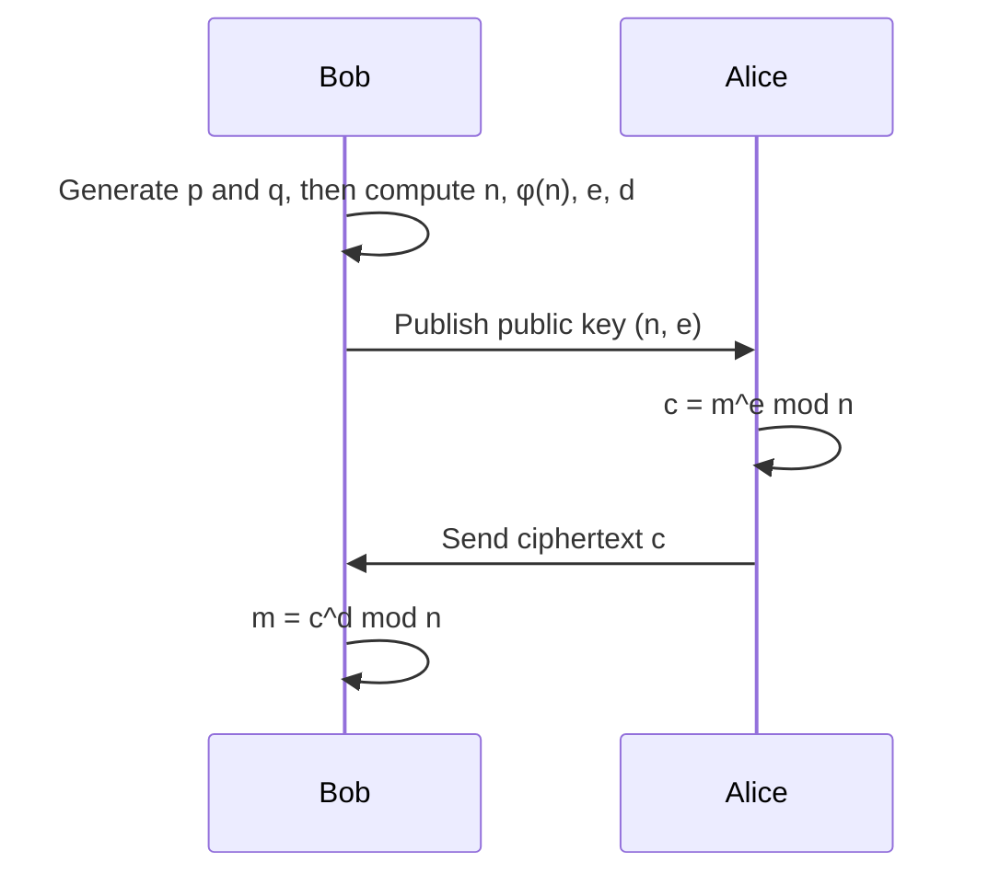

## 1. Overview

RSA, introduced by Rivest, Shamir and Adleman in 1977, is a public-key cryptosystem whose security rests on the presumed difficulty of factoring large integers. This article presents the *textbook* version: the mathematics is correct, but the scheme is deliberately incomplete. Padding and other hardening steps are discussed at the end, because omitting them is exactly what makes textbook RSA dangerous.

Throughout, we write $m$ for the plaintext, $c$ for the ciphertext, and assume $0 \le m < n$.

## 2. Key generation

### 2.1 Choosing the primes

Pick two distinct large primes $p$ and $q$ and compute

$$
n = pq, \qquad \varphi(n) = (p-1)(q-1),
$$

where $\varphi$ is Euler's totient function. For $n = pq$ with distinct primes, $\varphi(n) = (p-1)(q-1)$ holds because exactly the multiples of $p$ and of $q$ in $\{1, \dots, n\}$ are non-coprime to $n$.

### 2.2 Choosing the exponents

Choose a public exponent $e$ with

$$
1 < e < \varphi(n), \qquad \gcd(e, \varphi(n)) = 1,
$$

and compute the private exponent as the modular inverse of $e$:

$$
d \equiv e^{-1} \pmod{\varphi(n)}.
$$

Such a $d$ exists precisely because $\gcd(e, \varphi(n)) = 1$, and it can be computed with the extended Euclidean algorithm.

The public key is the pair $(n, e)$. The private key is $d$; $p$, $q$ and $\varphi(n)$ must be kept secret as well, since anyone who knows $\varphi(n)$ can recover $d$ from $e$.

## 3. Encryption and decryption

Given a public key $(n, e)$, encryption and decryption are simply modular exponentiation:

$$
\begin{aligned}
\text{Encrypt:}\quad & c \equiv m^{e} \pmod{n} \\
\text{Decrypt:}\quad & m \equiv c^{d} \pmod{n}
\end{aligned}
$$

Both operations take $O(\log e)$ or $O(\log d)$ modular multiplications using square-and-multiply, so they are efficient even for 2048-bit moduli.

The exchange between two parties looks like this:



## 4. Correctness proof

We must show that decryption recovers the message: $c^{d} \equiv m \pmod n$ for all $m$.

Since $ed \equiv 1 \pmod{\varphi(n)}$, there is an integer $k \ge 0$ with

$$
ed = 1 + k\,\varphi(n).
$$

### 4.1 The case $\gcd(m, n) = 1$

Euler's theorem states that $m^{\varphi(n)} \equiv 1 \pmod n$ whenever $\gcd(m, n) = 1$. Therefore

$$
c^{d} \equiv m^{ed} = m \cdot \left(m^{\varphi(n)}\right)^{k} \equiv m \cdot 1^{k} = m \pmod n.
$$

### 4.2 The general case

The argument above fails only for the rare messages with $\gcd(m, n) > 1$, that is, $p \mid m$ or $q \mid m$. The identity still holds for these, and the Chinese Remainder Theorem (CRT) gives the cleanest proof:

- **Modulo $p$.** If $p \mid m$, both $m^{ed}$ and $m$ are $\equiv 0 \pmod p$. If $p \nmid m$, Fermat's little theorem gives $m^{p-1} \equiv 1 \pmod p$, and since $ed - 1$ is a multiple of $(p-1)(q-1)$, we get $m^{ed} \equiv m \pmod p$.
- **Modulo $q$.** The same argument with $q$ in place of $p$.

Because $p$ and $q$ are distinct primes, $m^{ed} \equiv m \pmod p$ and $m^{ed} \equiv m \pmod q$ together imply $m^{ed} \equiv m \pmod{pq}$ by the CRT. So decryption is correct for every $m$.

## 5. Worked example

Take the classic small parameters below. They are far too small to be secure; they are chosen so every number can be checked by hand.

| Symbol | Meaning | Value |
|---|---|---|
| $p, q$ | distinct primes | $61$, $53$ |
| $n$ | modulus $pq$ | $3233$ |
| $\varphi(n)$ | $(p-1)(q-1)$ | $3120$ |
| $e$ | public exponent | $17$ |
| $d$ | private exponent | $2753$ |
| $m$ | plaintext | $65$ |
| $c$ | ciphertext | $2790$ |

Check the private exponent: $17 \cdot 2753 = 46801 = 15 \cdot 3120 + 1$, so $ed \equiv 1 \pmod{3120}$.

Encryption gives $c \equiv 65^{17} \equiv 2790 \pmod{3233}$, and decryption gives $2790^{2753} \equiv 65 \pmod{3233}$.

The same computation in Python, using the built-in three-argument `pow` (`pow(e, -1, phi)` computes a modular inverse and requires Python 3.8+):

```python title="rsa_toy.py"
from math import gcd

# Key generation
p, q = 61, 53
n = p * q
phi = (p - 1) * (q - 1)
e = 17
assert gcd(e, phi) == 1
d = pow(e, -1, phi)          # d = e^{-1} mod phi(n)

# Encryption and decryption
m = 65
c = pow(m, e, n)             # c = m^e mod n
m_recovered = pow(c, d, n)   # m = c^d mod n

print(f"n={n}, phi={phi}, d={d}")  # n=3233, phi=3120, d=2753
print(f"c={c}")                    # c=2790
assert m_recovered == m
```

## 6. Why textbook RSA is insecure

> [!WARNING]
> Textbook RSA as described above must **not** be used to encrypt real data. It is deterministic and malleable, and it leaks information about the plaintext in several ways.

Two problems stand out:

- **Deterministic encryption.** The same message always produces the same ciphertext. An attacker who suspects the plaintext is one of a small set of candidates (for example `YES` or `NO`) can simply encrypt each candidate with the public key and compare.
- **Malleability.** Multiplying ciphertexts multiplies plaintexts: $(m_1^e)(m_2^e) = (m_1 m_2)^e \pmod n$. An attacker can therefore transform a ciphertext into a valid encryption of a related message without knowing the private key.

Real deployments use a *padding* scheme. **OAEP** (Optimal Asymmetric Encryption Padding) mixes the message with random bytes before exponentiation, which makes encryption randomized and removes the structure that these attacks depend on. Signatures need their own padding (for example PSS) for the same reason.

## 7. Small exponent attack

Another pitfall is a small public exponent combined with a short message. Suppose $e = 3$ and $m^3 < n$. Then the reduction modulo $n$ never happens:

$$
c = m^3 \quad \text{as integers, not just modulo } n.
$$

An attacker who sees $c$ simply computes the integer cube root of $c$ and recovers $m$, with no factoring needed.

A tiny example with $n = 3233$ and $e = 3$: encrypting $m = 7$ gives $c = 7^3 = 343 < 3233$. The integer cube root of $343$ is exactly $7$.

This is why practical systems use a public exponent such as $e = 65537$ and pad messages to full length, so that $m^e$ always exceeds $n$ and the attack does not apply. Padding such as OAEP addresses this as well.
