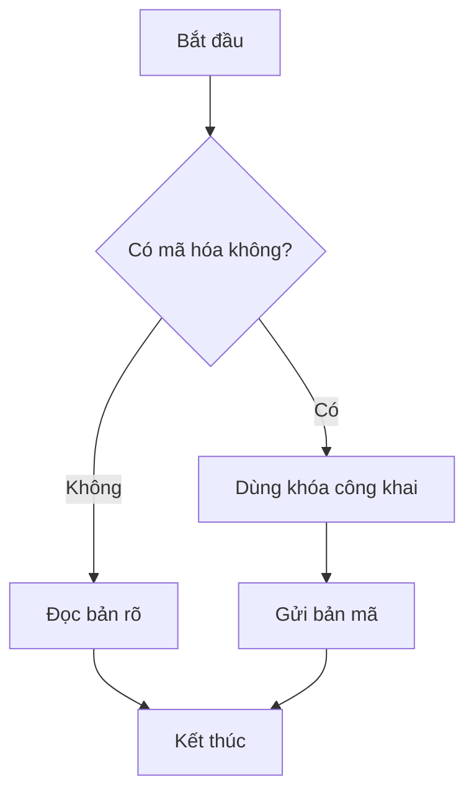

## 1. Giới thiệu

Bài này là một trang mẫu. Nó minh họa toàn bộ cú pháp mà blog hỗ trợ, để bạn tham khảo khi viết bài mới. Mọi thứ viết bằng Markdown thuần, cộng thêm vài quy ước nhỏ cho công thức toán và khối code.

## 2. Công thức toán

### 2.1 Công thức inline

Dùng dấu `$...$` để viết công thức nằm trong dòng chữ. Ví dụ, nhóm nhân các phần tử khả nghịch modulo $n$ là $\Z_n^*$, và $\varphi(n) = |\Z_n^*|$. Với mọi $a \in \Z_n^*$ ta có $a^{\varphi(n)} \equiv 1 \pmod n$.

### 2.2 Công thức display

Dùng `$$...$$` để viết công thức riêng một khối, căn giữa:

$$
\gcd(a, b) \cdot \operatorname{lcm}(a, b) = |ab|
$$

Công thức nhiều dòng dùng môi trường `aligned`:

$$
\begin{aligned}
x &\equiv 2 \pmod 3 \\
x &\equiv 3 \pmod 5 \\
x &\equiv 2 \pmod 7
\end{aligned}
$$

### 2.3 Ma trận

$$
M = \begin{pmatrix} 1 & 1 \\ 1 & 0 \end{pmatrix}, \qquad
M^n = \begin{pmatrix} F_{n+1} & F_n \\ F_n & F_{n-1} \end{pmatrix}
$$

### 2.4 Các macro có sẵn

Blog định nghĩa sẵn một số macro để gõ nhanh các ký hiệu hay dùng trong mật mã và lý thuyết số:

| Macro | Hiển thị | Ví dụ |
|---|---|---|
| `\Z` | $\Z$ | $\Z_{26}$ |
| `\N` | $\N$ | $n \in \N$ |
| `\F` | $\F$ | $\F_{2^8}$ |
| `\lcm` | $\lcm$ | $\lcm(4, 6) = 12$ |
| `\ord` | $\ord$ | $\ord_{11}(3) = 5$ |

Ví dụ kết hợp: $\ord_{n}(g) = \min\{k \in \N : g^k \equiv 1 \pmod n\}$.

## 3. Khối code

### 3.1 Code có tiêu đề

Thêm `title="..."` sau tên ngôn ngữ để đặt tên file hiển thị trên đầu khối:

```python title="caesar.py"
def caesar(text: str, shift: int) -> str:
    out = []
    for ch in text:
        if ch.isascii() and ch.isalpha():
            base = ord('A') if ch.isupper() else ord('a')
            out.append(chr((ord(ch) - base + shift) % 26 + base))
        else:
            out.append(ch)
    return "".join(out)

print(caesar("Hello, World!", 3))  # Khoor, Zruog!
```

### 3.2 Đánh số dòng

Mặc định, code của ngôn ngữ lập trình có số dòng. Có thể bật hoặc tắt bằng `linenums` / `nolinenums`:

```c linenums
#include <stdio.h>

int main(void) {
    printf("xin chào\n");
    return 0;
}
```

```javascript nolinenums
const sum = (a, b) => a + b;
console.log(sum(2, 3));
```

## 4. Khối terminal

Với `bash`, `console`, `sh` hoặc `powershell`, khối được hiển thị như cửa sổ terminal và không có số dòng:

```bash
$ openssl rand -hex 16
3f9a0c71e2b84d5a9c6e1f7b2d4a8e30

$ echo -n "mq" | sha256sum
f3c4a1d8e2b7...  -
```

```console
$ python3 -c "print(pow(65, 17, 3233))"
2790
```

## 5. Sơ đồ Mermaid

Khối ` ```mermaid ` được vẽ thành sơ đồ ngay trên trang:



## 6. Callout

Callout dùng cú pháp blockquote của GitHub, bắt đầu bằng một trong năm loại sau:

> [!NOTE]
> Ghi chú: thông tin bổ sung mà người đọc nên biết.

> [!TIP]
> Mẹo: một cách làm ngắn gọn hoặc hiệu quả hơn.

> [!IMPORTANT]
> Quan trọng: điều bắt buộc phải nắm để hiểu phần sau.

> [!WARNING]
> Cảnh báo: hiểu sai ở đây có thể dẫn tới lỗi bảo mật hoặc kết quả sai.

> [!CAUTION]
> Thận trọng: hành động có thể gây hậu quả khó đảo ngược.

## 7. Bảng, danh sách và trích dẫn

| Thuật toán | Loại | Kích thước khóa khuyến nghị |
|:---|:---:|---:|
| AES | Đối xứng | 128 hoặc 256 bit |
| RSA | Bất đối xứng | Tối thiểu 2048 bit |
| ECDSA (P-256) | Chữ ký | 256 bit |

Danh sách không thứ tự:

- Mã hóa đối xứng dùng chung một khóa.
- Mã hóa bất đối xứng dùng cặp khóa công khai / bí mật.
    - Khóa công khai có thể chia sẻ tự do.
    - Khóa bí mật phải được giữ kín.

Danh sách có thứ tự:

1. Sinh khóa.
2. Mã hóa bản rõ.
3. Giải mã bản mã.

Trích dẫn:

> Một hệ mật mà an toàn chỉ phụ thuộc vào việc giữ bí mật khóa, còn thuật toán thì được công khai, là nguyên lý Kerckhoffs.

## 8. Lời kết

Chỉ cần nắm vài quy ước ở trên, bạn có thể viết một bài kỹ thuật đầy đủ: công thức, code, terminal và sơ đồ đều nằm trong một file `.md`.
